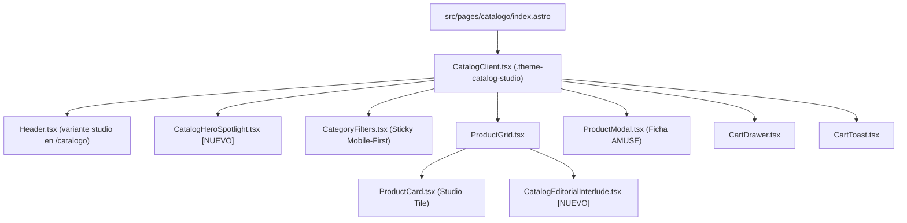

# Diseño: Rediseño Editorial Luminoso de `/catalogo` (Fusión Glossier + AMUSE)

Este documento define la especificación técnica, visual y arquitectónica para el rediseño *mobile-first* de la ruta `/catalogo` en **Bella Forever**. El objetivo es reemplazar la plantilla actual en modo oscuro genérico por una experiencia de estudio editorial luminoso inspirada en **Glossier** y **AMUSE**, manteniendo el ADN de marca de Bella Forever.

---

## 1. Lectura de Diseño y Parámetros Base

- **Design Read:** Rediseño integral (*Overhaul*) de `/catalogo` para consumidoras de belleza con prioridad móvil (*mobile-first*), con lenguaje editorial luminoso de estudio (fusión Glossier + AMUSE), construido sobre tokens CSS con ámbito de página (`.theme-catalog-studio`), Container Queries y micro-interacciones táctiles.
- **Dials de Configuración (`design-taste-frontend`):**
  - `DESIGN_VARIANCE: 7` (Hero Split asimétrico en desktop, colapso limpio en 1 columna en móvil; grilla de 2 columnas en móvil con interludio editorial intercalado a ancho completo).
  - `MOTION_INTENSITY: 5` (Transiciones físicas suaves en swatches y botones, entrada escalonada con respeto estricto a `prefers-reduced-motion`, cero listeners globales `mousemove`).
  - `VISUAL_DENSITY: 3` (Aire de galería cosmética donde el color del producto y la fotografía respiran sobre superficies claras).

---

## 2. Sistema de Tokens y Bloqueo de Tema (*Page Theme Lock*)

Siguiendo la regla de **Page Theme Lock** y **Color Consistency Lock**, toda la ruta `/catalogo` (incluyendo `Header`, `CatalogHeroSpotlight`, `CategoryFilters`, `ProductCard`, `CatalogEditorialInterlude`, `ProductModal`, `CartDrawer`, `CartToast` y `Footer`) se envuelve bajo la clase de alcance `.theme-catalog-studio` en `src/index.css` para garantizar una única atmósfera luminosa sin inversiones de color abruptas a mitad de página y sin alterar el tema oscuro de la página de inicio (`/`).

| Token Semántico | Valor | Uso |
| :--- | :--- | :--- |
| `--catalog-bg` | `#FBF6F7` | Superficie principal de página (alabastro rosado muy sutil). |
| `--catalog-surface-card` | `#F4ECEE` | Fondo de estudio para tarjetas de producto en reposo. |
| `--catalog-surface-elevated` | `#FFFFFF` | Tarjeta destacada en el Hero Spotlight, modales y hover de tarjetas. |
| `--catalog-surface-blush` | `#F7E2E5` | Superficie rosa empolvado Glossier para el panel derecho del Hero e Interludio Editorial. |
| `--catalog-ink` | `#24070E` | Texto primario borgoña profundo (contraste WCAG AAA sobre alabastro). |
| `--catalog-ink-muted` | `#6E4B53` | Texto secundario y metadatos (contraste WCAG AA >= 4.5:1). |
| `--catalog-accent` | `#8C1D32` | Acento único bloqueado (Carmesí/Berry editorial para bordes de marco, CTAs y estados activos). |
| `--catalog-accent-hover` | `#6B1324` | Estado hover/active del acento carmesí. |
| `--catalog-border` | `rgba(140, 29, 50, 0.16)` | Líneas divisorias finas y bordes de píldoras inactivas. |
| `--catalog-border-frame` | `2px solid #8C1D32` | Marco exterior editorial estilo Glossier para el Hero. |

### Regla de Consistencia de Forma (*Shape Consistency Lock*)
- **Contenedores editoriales y tarjetas:** `border-radius: 18px` (`--radius-catalog-card`).
- **Elementos interactivos (botones, filtros, etiquetas):** `border-radius: 9999px` (`--radius-pill`).

---

## 3. Arquitectura de Componentes y Flujo de Datos

### Responsabilidades por Unidad

1. **`src/components/CatalogHeroSpotlight.tsx` [NUEVO]:**
   - Recibe la lista de productos destacados (`featuredProducts`, con fallback a los primeros productos del catálogo) y los callbacks `onAddToCart` y `onProductClick`.
   - **Diseño Mobile-First (`< 768px`):**
     - Contenedor enmarcado con borde `--catalog-border-frame` (`2px solid #8C1D32`) y fondo `--catalog-surface-blush`.
     - Cabecera compacta con retrato editorial panorámico (`aspect-ratio: 16 / 9`, `max-height: 190px`, imagen `/images/studio-hero-blush.webp` o `/images/studio-velvet-gloss.webp`) con wordmark superpuesto `Bella.` en tipografía serif cursiva + sans.
     - Debajo, dentro del mismo marco, la **Tarjeta Spotlight estilo AMUSE** sobre fondo `#FFFFFF`: imagen limpia del producto activo (`aspect-ratio: 1 / 1`, `max-width: 180px` centrado), selector táctil de tonos (`tones`) con círculos de `26px` y anillo doble en el tono activo, precio en la esquina inferior izquierda, botón píldora carmesí `Agregar al pedido` y, si existen varios productos destacados, puntos/píldoras de paginación rápida para alternar el producto en vitrina.
   - **Escala Desktop (`>= 768px`):**
     - Grid 50/50 (`grid-template-columns: 1.05fr 0.95fr`, `min-height: 520px`).
     - Izquierda: retrato editorial a sangre completa.
     - Derecha: fondo `--catalog-surface-blush`, tarjeta blanca flotante en el centro con el producto interactivo, copy corto (máximo 16 palabras) y el wordmark gigante `Bella.` anclado al borde inferior derecho como en la referencia de Glossier.
   - **Restricción Hero Stack:** Máximo 4 elementos de texto (1 título del producto en spotlight, 1 descripción corta <= 18 palabras, precio/tono y 1 CTA primario).

2. **`src/components/CategoryFilters.tsx` [MODIFICAR]:**
   - Barra horizontal con `position: sticky; top: 70px; z-index: 40` sobre fondo `rgba(251, 246, 247, 0.88)` con `backdrop-filter: blur(12px)` y borde inferior sutil.
   - En móvil: tira deslizable horizontal (`overflow-x: auto`, `scroll-snap-type: x mandatory`, padding lateral `16px`) con píldoras limpias estilo Glossier.
   - Estado activo: relleno `--catalog-accent` (`#8C1D32`) con texto blanco `#FFFFFF` (contraste > 7:1). Estado inactivo: fondo transparente/alabastro con borde `--catalog-border` y texto `--catalog-ink`.
   - Muestra a la derecha (en desktop) o como etiqueta sutil el conteo de piezas mostradas (`N productos`).

3. **`src/components/ProductGrid.tsx` [MODIFICAR]:**
   - Elimina el `<style>` inline con `!important` y utiliza clases semánticas en `src/index.css`.
   - **Grid Mobile-First:**
     - Base (`< 768px`): `grid-template-columns: repeat(2, minmax(0, 1fr)); gap: 12px; padding: 16px;`.
     - Tablet (`>= 768px`): `grid-template-columns: repeat(3, minmax(0, 1fr)); gap: 24px; padding: 24px 32px;`.
     - Desktop (`>= 1024px`): `grid-template-columns: repeat(4, minmax(0, 1fr)); gap: 28px;`.
   - **Inyección del Interludio Editorial:**
     - Cuando la categoría activa es `'todos'` y hay más de 4 productos, renderiza `<CatalogEditorialInterlude />` ocupando todo el ancho de la fila (`grid-column: 1 / -1`) justo después de los primeros 4 productos (2 filas exactas en móvil, 1 fila completa en desktop de 4 columnas).

4. **`src/components/ProductCard.tsx` [MODIFICAR]:**
   - **Eliminación de deuda técnica:** Se remueve por completo el `window.addEventListener('mousemove', onMouseMove)` y las mutaciones imperativas de `.style`. Toda la interacción visual se delega a CSS declarativo.
   - **Anatomía Studio Tile (Mobile-First):**
     - **Caja de Imagen:** Superficie `--catalog-surface-card` (`#F4ECEE`), `aspect-ratio: 1 / 1`, `border-radius: 16px`, `padding: 12px` para que la imagen tenga aire de estudio. Si la imagen es foto completa se muestra con `border-radius: 12px` interno y zoom suave `scale(1.03)` en `@media (hover: hover)`.
     - **Badge Superior Derecho:** Píldora pequeña con borde carmesí fino (`Nuevo` o `Últimas N` si `isLowStock`), inspirada en el badge `1 oz` de la referencia Glossier.
     - **Swatches Táctiles (Estilo AMUSE):** Fila de círculos de color (`20px` en móvil, `22px` en desktop) con anillo exterior `--catalog-accent` en el tono activo. Si el producto tiene más de 5 tonos en móvil, muestra los primeros 5 más un indicador `+N` para no romper la altura de la tarjeta.
     - **Pie de Tarjeta:** Nombre del producto en `Outfit` (`font-weight: 500`, `color: var(--catalog-ink)`, 1-2 líneas) y precio en formato moneda local con tipografía limpia, acompañados de un botón píldora compacto `Agregar` (1 sola línea garantizada, contraste WCAG AA).

5. **`src/components/CatalogEditorialInterlude.tsx` [NUEVO]:**
   - Inspirado directamente en el bloque *"Our Philosophy"* de la referencia Glossier:
     - Superficie `--catalog-surface-blush` (`#F7E2E5`) con `border-radius: 18px` y `padding: 24px 20px` en móvil (`36px 40px` en desktop).
     - Parte superior: píldora con borde fino `Curaduría Bella` a la izquierda y dúo de mini-recortes fotográficos cuadrados (`64px` en móvil, `88px` en desktop) a la derecha mostrando texturas de labiales y rubor.
     - Cuerpo tipográfico: declaración editorial de 2-3 líneas en color `--catalog-accent` (`#8C1D32`) combinando `Outfit` regular con palabras clave en `Cormorant Garamond` *italic* (con `line-height: 1.18` y `padding-bottom: 4px` para evitar recorte de descendentes).

6. **`src/components/ProductModal.tsx` y `src/components/Header.tsx` [MODIFICAR]:**
   - `Header`: Cuando recibe `isCatalog={true}`, aplica superficie traslúcida luminosa (`rgba(251, 246, 247, 0.88)`), texto e iconos en `--catalog-ink` y `--catalog-accent`, manteniendo coherencia total con el catálogo.
   - `ProductModal`: Adopta el diseño de ficha de producto **AMUSE ("Bebe tint")** en móvil y desktop: fondo blanco/alabastro, título del producto con acento editorial en `Cormorant Garamond` *italic*, galería cuadrada limpia, selector de tonos con halo carmesí y CTA principal en `--catalog-accent` (`#8C1D32`) con texto blanco.

---

## 4. Manejo de Estados, Accesibilidad y Rendimiento

- **Estados vacíos y sin stock:**
  - Si una categoría no tiene productos, `ProductGrid` muestra un estado vacío luminoso con botón píldora `( Ver todos los productos )` que restablece `activeCategory` a `'todos'`.
  - Si un tono o producto está agotado, el swatch se muestra con opacidad `0.35` y trazo diagonal sutil, y el botón cambia a `Agotado` deshabilitado con contraste legible.
- **Accesibilidad (WCAG AA):**
  - Todos los textos sobre `#FBF6F7`, `#F4ECEE` y `#F7E2E5` usan `#24070E` o `#8C1D32`, superando `4.5:1` en texto normal y `7:1` en titulares.
  - Botones de tonos incluyen `aria-label="Seleccionar tono {nombre}"` y `aria-pressed={isSelected}`.
- **Rendimiento y Core Web Vitals:**
  - La imagen principal del `CatalogHeroSpotlight` se marca con `loading="eager"` y `fetchPriority="high"` para optimizar el LCP en móvil y desktop.
  - Se elimina el `FeaturedCarousel` redundante de `/catalogo` para reducir nodos DOM e imágenes duplicadas en el arranque.

---

## 5. Criterios de Verificación

1. **Verificación Mobile-First (`375px` y `390px` de ancho):**
   - El Hero Spotlight cabe en el viewport inicial permitiendo ver el retrato editorial, el producto destacado con sus tonos, el precio y el botón `Agregar al pedido` sin desbordamiento horizontal.
   - La barra de filtros se mantiene sticky bajo el header al hacer scroll y la grilla renderiza 2 columnas limpias con CTAs en una sola línea.
2. **Consistencia de Tema y Reglas Anti-Slop:**
   - Cero caracteres *em-dash* o *en-dash* en todo el código visible.
   - Toda la página `/catalogo` (incluyendo header, modal de producto y footer) respeta el tema luminoso de estudio sin secciones oscuras huérfanas.
3. **Pruebas y Compilación:**
   - `npm run build` / verificación de tipos de Astro y TypeScript sin errores.
