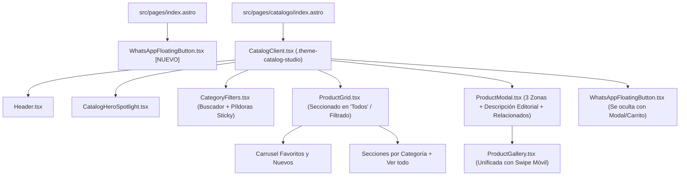

# Diseño: Optimización Móvil del Detalle de Producto, Búsqueda en Tiempo Real, Seccionamiento del Catálogo y Atención por WhatsApp

Este documento define la especificación técnica, visual y arquitectónica para la evolución *mobile-first* del catálogo de **Bella Forever** (`/catalogo` y `/`). El objetivo es resolver los cuellos de botella de experiencia móvil en la ficha de detalle de producto (`ProductModal`), enriquecer la presentación de las descripciones, ofrecer productos relacionados/destacados dentro del modal, incorporar búsqueda instantánea en el catálogo, seccionar la vista general ("Todos") y habilitar un botón flotante inteligente de atención por WhatsApp (`3117887806`).

---

## 1. Lectura de Diseño y Parámetros Base

- **Design Read:** Evolución *mobile-first* de catálogo de cosmética de lujo para consumidoras móviles, conservando el lenguaje **Chiaroscuro de Lujo (Glossier + AMUSE en Nocturno)** bajo `.theme-catalog-studio`, con ergonomía de zona del pulgar (*Thumb-Zone Sticky Footer*), buscador reactivo y navegación seccionada.
- **Dials de Configuración (`design-taste-frontend`):**
  - `DESIGN_VARIANCE: 7` (Banda horizontal curada de Favoritos/Nuevos + secciones editoriales por categoría + modal con layout de 3 zonas en móvil y 2 columnas en desktop).
  - `MOTION_INTENSITY: 5` (Transiciones suaves en acordeones, cambio de producto dentro del modal, gestos táctiles en galería y ocultamiento reactivo del botón flotante de WhatsApp, respetando `prefers-reduced-motion`).
  - `VISUAL_DENSITY: 3` (Jerarquía clara de información con lectura cómoda en pantallas de `360px - 430px`).

---

## 2. Arquitectura de Componentes y Flujo de Datos

### Responsabilidades por Unidad

1. **`src/components/ProductGallery.tsx` [MODIFICAR]:**
   - **Problema actual:** `hasGallery = !selectedToneImage && galleryImages.length > 1` oculta la galería de miniaturas apenas hay un tono seleccionado.
   - **Solución:** Construye una lista unificada de imágenes donde la imagen del tono activo (si existe) se posiciona como vista principal o primer ítem sincronizado con las demás imágenes de `productImages`, manteniendo siempre visibles las miniaturas cuando hay más de una imagen total.
   - **Soporte táctil en móvil:** Añade soporte de deslizamiento horizontal (*touch swipe* izquierdo/derecho), contador de foto (`1 / N`), flechas sutiles y miniaturas de `60x60px` fáciles de tocar.

2. **`src/components/ProductModal.tsx` [MODIFICAR]:**
   - **Arquitectura en 3 Zonas para Móvil (`max-height: 92dvh`):**
     1. **Cabecera Fija (`flexShrink: 0`):** Etiqueta de categoría, *drag handle* táctil y botón de cierre de `38x38px`.
     2. **Cuerpo Desplazable (`flex: 1 1 auto; overflow-y: auto`):**
        - **Galería y Cabecera de Producto:** Galería cuadrada con badges de estado (`Nuevo`, `Favorito de Estudio`, `Últimas N unidades`), título editorial en `Cormorant Garamond` *italic* y precio + estado de stock.
        - **Selector de Tonos Ergonómico:** Swatches de `34px` en móvil con etiqueta del tono seleccionado, indicador claro de disponibilidad y cambio instantáneo de imagen.
        - **Descripción Editorial Mejorada (sin tocar esquema de BD):**
          - Formatea el texto de `product.description` en lectura editorial cómoda (`line-height: 1.65`) y extrae/presenta **Chips de Atributos de Estudio** (ej. *Acabado Profesional*, *Alta Pigmentación*, *Entrega en Roldanillo*, *N Tonos Disponibles*).
          - **Acordeones Informativos Interactivos:**
            - *"Beneficios y Aplicación"*: Guía práctica de uso según la categoría del producto (`rubor`, `labiales`, `cejas`, `pestanas`, `correctores`).
            - *"Entrega y Garantía Bella Forever"*: Información de entrega rápida en Roldanillo y envíos, más un botón de **"Consultar por este producto en WhatsApp"** que abre `https://wa.me/573117887806` con el nombre del producto y tono prellenados.
        - **Sección "Completa tu Look / Productos Relacionados y Destacados":**
          - Recibe `allProducts` desde `CatalogClient` y calcula hasta 6 productos recomendados: prioriza productos de la misma categoría (`p.category === product.category && p.id !== product.id`) y complementa con productos destacados (`p.isFeatured || p.isNew`).
          - Renderiza un carrusel horizontal táctil con tarjetas compactas que permiten **ver el producto** (cambiando el producto activo del modal con scroll suave al inicio via `onSelectProduct`) o **agregarlo directo al pedido**.
     3. **Barra Inferior Fija (*Sticky CTA Bar*):**
        - Siempre visible al pie del modal en móvil (con soporte `env(safe-area-inset-bottom)`), mostrando el resumen del precio + tono elegido a la izquierda y el botón principal **"Agregar al pedido"** a la derecha.

3. **`src/components/CategoryFilters.tsx` [MODIFICAR]:**
   - Incorpora un buscador en tiempo real (`searchQuery`, `onSearchChange`) integrado armoniosamente en la barra sticky junto a las píldoras de categoría.
   - Input con icono de búsqueda, placeholder *"Buscar rubor, labial, tono o acabado..."*, botón para limpiar (`✕`) cuando hay texto y contador de resultados actualizado.
   - Normalización de texto sin tildes (`normalize('NFD').replace(/[\u0300-\u036f]/g, '')`) en `CatalogClient.tsx` para buscar en `name`, `description`, `category` y `tones[].name`.

4. **`src/components/ProductGrid.tsx` [MODIFICAR]:**
   - **Modo Seccionado (cuando `activeCategory === 'todos'` y `searchQuery.trim() === ''`):**
     1. **Banda Curada "Favoritos & Nuevos Lanzamientos":** Carrusel horizontal deslizable con tarjetas de los productos marcados con `isFeatured` o `isNew` para descubrimiento inmediato en móvil.
     2. **Secciones por Categoría:** Agrupa los productos por cada categoría activa del catálogo (`Rubor`, `Labiales`, `Cejas`, `Pestañas`, `Correctores`, o categorías dinámicas de D1). Cada sección muestra:
        - Cabecera editorial con nombre de la colección, subtítulo descriptivo corto, conteo de referencias y botón **"Ver sección (N) →"** que filtra esa categoría.
        - Grilla de productos de esa categoría.
     3. **Interludio Editorial (`CatalogEditorialInterlude`):** Ubicado estratégicamente después de la primera sección de categoría para dar ritmo visual de revista.
   - **Modo Enfoque / Búsqueda (cuando hay una categoría específica activa o `searchQuery` con texto):**
     - Muestra la grilla enfocada con encabezado contextual (ej. *"Resultados para «...»"* o *"Selección Rubor"*) y estado vacío enriquecido con botón para limpiar filtros/búsqueda.

5. **`src/components/ui/WhatsAppFloatingButton.tsx` [NUEVO]:**
   - Botón flotante accesible (`aria-label="Atención al cliente por WhatsApp"`) que redirige a `https://wa.me/573117887806?text=...` usando el número oficial `3117887806` (`CONFIG.whatsappNumber`).
   - Diseño acorde a la estética de lujo de Bella Forever (acento dorado + verde esmeralda sutil o cápsula nocturna con pulso suave, etiqueta expandible en desktop y botón circular limpio de `54x54px` en móvil).
   - Prop `isHidden?: boolean` para ocultarse suavemente cuando `selectedProduct !== null` (modal abierto) o `isCartOpen === true` (carrito abierto), y ajuste de posición cuando hay un `CartToast` activo.
   - Integrado tanto en `src/components/CatalogClient.tsx` como en `src/pages/index.astro`.

---

## 3. Criterios de Verificación

1. **Verificación de Tipos y Linter:** `npm run typecheck` y `npm run lint` sin errores ni advertencias.
2. **Build de Producción:** `npm run build` compila satisfactoriamente el bundle SSR de Cloudflare y cliente React.
3. **Ergonomía Móvil:** En resoluciones móviles (`375x812`), el modal de producto mantiene fijo el botón de compra abajo, permite deslizar fotos sin ocultar miniaturas al cambiar de tono, despliega detalles/beneficios, permite navegar a productos relacionados y nunca se superpone con el botón flotante de WhatsApp.
